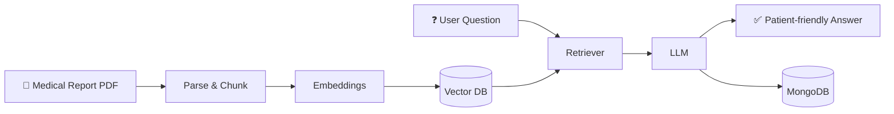
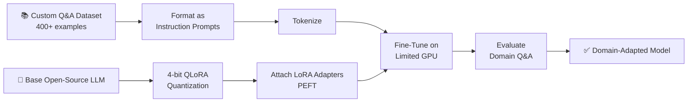
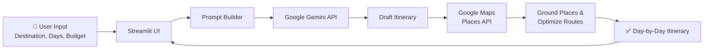

<!-- ========================= HEADER ========================= -->
<div align="center">

<!--  -->

[](https://git.io/typing-svg)

<br/>

[](https://www.linkedin.com/in/arpan0009e)
[](https://www.kaggle.com/arpan0009e)
[](mailto:arpanmondal708@gmail.com)
[](https://drive.google.com/file/d/1o5NIxA7jt3gwbkxdDijbH9VYNXVRJwmw/view?usp=sharing)


<br/>


</div>

---

##  About

```python
class Arpan:
    name        = "Arpan Mondal"
    role        = "Aspiring AI / ML Engineer"
    education   = "B.Tech in AI & ML @ NIMS University, Jaipur (2023 – 2027)"
    based_in    = "Jaipur / Kolkata, India 🇮🇳"
    languages   = ["English", "Hindi", "Bengali"]

    focus = [
        "LLM apps with Retrieval-Augmented Generation (RAG)",
        "Parameter-efficient fine-tuning (LoRA / QLoRA)",
        "Production-ready APIs with FastAPI",
        "End-to-end ML pipelines: data -> model -> deploy",
    ]

    learning    = ["Transformers internals", "MLOps (Docker, DVC, AWS)", "Agentic systems"]
    status      = "🟢 Open to AI/ML internships & entry-level roles"
    goal        = "Become an AI Engineer who ships reliable, useful AI products"

    def say_hi(self):
        print("Thanks for stopping by. Let's build something great together!")
```

---

##  Tech Stack

<div align="center">

### Languages


### ML / Deep Learning


### GenAI & NLP
`RAG` · `Vector DBs (FAISS, ChromaDB)` · `Embeddings` · `LoRA / QLoRA / PEFT` · `Prompt Engineering` · `NLTK` · `Tokenization`

### Backend & Databases


### Frontend


### Cloud, MLOps & Tools


</div>

---

##  Featured Projects

###  [MedExplain](https://github.com/arpan0009e/MedExplain) — Medical Report Explanation Platform
> Turns complex medical reports into clear, patient-friendly explanations using an LLM + RAG pipeline.

- Built with **FastAPI + Pydantic**, with PDF/document processing, embeddings, and **vector-database retrieval** to ground answers in authoritative medical sources
- **MongoDB** persistence for context-aware, follow-up Q&A
- `Python` `FastAPI` `Pydantic` `RAG` `Vector DB` `MongoDB` `LLM`



<br/>

###  Domain-Specific LLM Fine-Tuning (LoRA / QLoRA)
> Adapted an open-source LLM to a niche Q&A domain on limited GPU resources.

- Curated a custom instruction-style dataset of **400+ Q&A examples**
- Applied **LoRA + 4-bit QLoRA quantization** (PEFT) to fine-tune efficiently while preserving the base model's general language ability
- `Python` `PyTorch` `Hugging Face Transformers` `PEFT` `QLoRA`



<br/>

###  AI Travel Planner
> Generates personalized, budget-aware, day-by-day travel itineraries.

- Powered by the **Google Gemini API**; recommendations are grounded in real places via the **Google Maps Places API**
- Deployed on **Streamlit Community Cloud**
- `Python` `Gemini API` `Streamlit` `Google Maps API`



<br/>

###  More ML Projects

| Project | What it does | Stack |
|---|---|---|
| [**House Price Prediction**](https://github.com/arpan0009e/House_Price_Prediciton) | Regression model with preprocessing and visualization | `Scikit-learn` `Pandas` |
| [**Food Delivery Time Prediction**](https://github.com/arpan0009e/Food_Delivery_Time_Prediction) | Feature engineering on a real-world dataset to predict ETA | `NumPy` `Scikit-learn` |

<div align="center">

[](https://github.com/arpan0009e?tab=repositories)

</div>

---

##  Experience

<table>
<tr>
<td width="180"><b>Sept 2025 – Oct 2025</b><br/><sub>Remote</sub></td>
<td>

**AI & Cloud Technology Intern** — *Edunet Foundation*

- Built end-to-end **ML pipelines in Python**: preprocessing, training, evaluation, and deployment
- Collaborated with a cross-functional team on scalable AI solutions, improving **model inference time by 20%**

</td>
</tr>
</table>

---

##  Education 

**B.Tech — Artificial Intelligence & Machine Learning**, NIMS University, Jaipur · *Jul 2023 – May 2027*
<br/>
<sub>Coursework: Data Structures · AI · Machine Learning · Deep Learning · NLP · Cloud Computing</sub>

**All India Senior School Certificate Examination**, Jawahar Navodaya Vidyalaya, West Medinipur · *Jul 2022*
<br/>
<sub>Coursework: Computer Science · Physics · Chemistry ·Mathematics</sub>


---

##  Currently

| | |
|---|---|
|  **Working on** | Deployable, end-to-end LLM / RAG applications |
|  **Learning** | Transformers & NLP internals, MLOps with Docker, DVC and AWS |
|  **Open to** | AI/ML internships (including PPO), entry-level roles, and open-source collaboration |
|  **Ask me about** | RAG pipelines, QLoRA fine-tuning, FastAPI, ML pipelines |

---

##  GitHub Stats

<div align="center">


<br/>


<br/><br/>


</div>

---

##  Let's Connect

<div align="center">

I'm actively looking for **AI/ML internship and entry-level opportunities**. If you're building something with LLMs, RAG, or applied ML, I'd love to chat.

[](https://www.linkedin.com/in/arpan0009e)
[](mailto:arpanmondal708@gmail.com)
[](https://drive.google.com/file/d/1o5NIxA7jt3gwbkxdDijbH9VYNXVRJwmw/view?usp=sharing)

<br/>

*"The best way to predict the future is to build it."*


</div>
