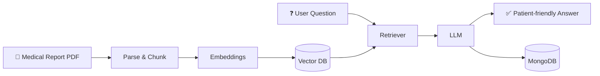

<!-- ========================= HEADER ========================= -->
<div align="center">


<h3>AI and ML student building RAG apps, LoRA fine-tuning and FastAPI services, end to end from data to deploy. Looking for an AI/ML internship.</h3>

[](https://git.io/typing-svg)

<br/>

[](https://www.linkedin.com/in/arpan0009e)
[](https://www.kaggle.com/arpan0009e)
[](mailto:arpanmondal708@gmail.com)
[](https://drive.google.com/file/d/1IGuotaJAfTAy1boZ6i9ccveX6AL2itE3/view?usp=sharing)


<br/>


</div>

<br/>

<!-- ========================= ABOUT ========================= -->

## 👋 About Me

<table>
<tr>
<td width="55%" valign="top">

I'm a final-year **B.Tech AI & ML** student at **NIMS University, Jaipur**. Most of what I build starts with a plain question: *how do I get a model's answer in front of a real user, and make sure it can be trusted?*

That's why my projects don't stop at a notebook. [MedExplain](https://github.com/arpan0009e/MedExplain) retrieves from authoritative medical sources before the LLM answers. My AI Travel Planner checks its suggestions against real places on Google Maps. And at Edunet I worked on cutting inference time, not just training accuracy.

**Right now I'm sharpening:** transformer internals, MLOps with Docker, DVC and AWS, and agentic systems.

**Goal:** become an AI Engineer who ships reliable, useful AI products.

</td>
<td width="45%" valign="top">

```python
class Arpan:
    role      = "Aspiring AI/ML Engineer"
    education = "B.Tech AI & ML, 2023-2027"
    languages = ["English", "Hindi", "Bengali"]

    builds    = [
        "RAG apps",
        "LoRA / QLoRA fine-tuning",
        "FastAPI services",
        "End-to-end ML pipelines",
    ]

    learning  = [
        "Transformers internals",
        "MLOps: Docker, DVC, AWS",
        "Agentic systems",
    ]

    status    = "🟢 Open to AI/ML internships"
```

</td>
</tr>
</table>

---

## 🧰 Tech Stack

<div align="center">

| | |
|:---:|:---|
| **Languages** |  |
| **ML / DL** |  |
| **Backend & DB** |  |
| **Frontend** |  |
| **Cloud & Tools** |  |

<br/>


**GenAI & NLP:** `RAG` · `FAISS` · `ChromaDB` · `Embeddings` · `LoRA / QLoRA / PEFT` · `Prompt Engineering` · `NLTK` · `Tokenization`

</div>

---

## 🚀 Featured Projects

### 🩺 [MedExplain](https://github.com/arpan0009e/MedExplain): Medical Report Explanation Platform

> **The problem:** medical reports are full of jargon patients can't parse.
> **The approach:** an LLM + RAG pipeline that explains the report in plain language, grounded in authoritative medical sources instead of the model's guesswork.

- **FastAPI + Pydantic** backend with typed request/response models
- PDF/document processing, embeddings and **vector-database retrieval** so answers cite real sources
- **MongoDB** persistence keeps context, so patients can ask follow-up questions
- `Python` `FastAPI` `Pydantic` `RAG` `Vector DB` `MongoDB` `LLM`



<br/>

### ✈️ AI Travel Planner

> **The problem:** LLM travel plans often include places that don't exist or routes that make no sense.
> **The approach:** let Gemini draft the itinerary, then ground every stop with the Google Maps Places API.

- Personalized, **budget-aware, day-by-day** itineraries from destination, days and budget
- Powered by the **Google Gemini API**, grounded with the **Google Maps Places API**
- Deployed on **Streamlit Community Cloud**
- `Python` `Gemini API` `Streamlit` `Google Maps API`


<br/>

### 📊 More ML Projects

| Project | What it does | Stack |
|---|---|---|
| [**House Price Prediction**](https://github.com/arpan0009e/House_Price_Prediciton) | Regression model with preprocessing and visualization | `Scikit-learn` `Pandas` |
| [**Food Delivery Time Prediction**](https://github.com/arpan0009e/Food_Delivery_Time_Prediction) | Feature engineering on a real-world dataset to predict ETA | `NumPy` `Scikit-learn` |

<div align="center">

[](https://github.com/arpan0009e?tab=repositories)

</div>

---

## 💼 Experience

<table>
<tr>
<td width="200" valign="top"><b>Sept 2025 – Oct 2025</b><br/><sub>Remote</sub></td>
<td>

**AI & Cloud Technology Intern** · *Edunet Foundation*

- Built end-to-end **ML pipelines in Python**: preprocessing, training, evaluation, and deployment
- Worked with a cross-functional team on scalable AI solutions, improving **model inference time by 20%**

</td>
</tr>
</table>

---

## 🎓 Education

| | |
|---|---|
| **B.Tech, Artificial Intelligence & Machine Learning**<br/><sub>NIMS University, Jaipur · Jul 2023 – May 2027</sub> | <sub>Data Structures · AI · Machine Learning · Deep Learning · NLP · Cloud Computing</sub> |
| **AISSCE (Class XII)**<br/><sub>Jawahar Navodaya Vidyalaya, West Medinipur · Jul 2022</sub> | <sub>Computer Science · Physics · Chemistry · Mathematics</sub> |

---

## 🎯 Currently

| | |
|---|---|
| 🛠️ **Working on** | Deployable, end-to-end LLM / RAG applications |
| 📚 **Learning** | Transformers & NLP internals, MLOps with Docker, DVC and AWS |
| 🤝 **Open to** | AI/ML internships (including PPO), entry-level roles, open-source collaboration |
| 💬 **Ask me about** | RAG pipelines, QLoRA fine-tuning, FastAPI, ML pipelines |

---

## 📈 GitHub Stats

<div align="center">


<br/>


<br/><br/>


</div>

---

## 📬 Let's Connect

<div align="center">

I'm actively looking for **AI/ML internship and entry-level opportunities**.
If you're building something with LLMs, RAG, or applied ML, I'd love to chat.

[](https://www.linkedin.com/in/arpan0009e)
[](mailto:arpanmondal708@gmail.com)
[](https://drive.google.com/file/d/1IGuotaJAfTAy1boZ6i9ccveX6AL2itE3/view?usp=sharing)

<br/>

*"The best way to predict the future is to build it."*


</div>
